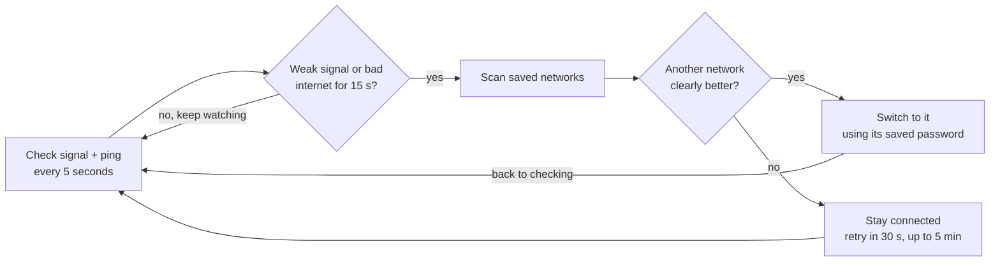

# Thunder WiFi Switcher – PRD

Last updated: Nov 20, 2026

Thunder WiFi Switcher is a free, open-source app for macOS and Windows that keeps you on the network with the best internet, not just the strongest signal. v1.0 targets students in dorms and shared housing.

## Problem

Laptops stay on the Wi-Fi network they joined, even after it turns weak or overloaded. macOS does not switch to a stronger saved network while still connected. Windows only roams between access points that share one network name.

In a dorm with several networks, this means slow pages, buffering and dropped calls while a better network sits in range. Users fix it by hand: open the Wi-Fi menu, compare networks, switch, and repeat.

Signal strength alone is not enough either. A network can show a strong signal and still have high ping or no internet when many people use it.

## Target users

- **Primary:** students in dorms with several Wi-Fi networks in range.
- **Secondary:** people in shared housing, boarding houses (kos) and co-living spaces.
- **Also:** homes with a router plus an extender that use different network names.

All of them use a MacBook or a Windows laptop, move around a building, and don't want to manage Wi-Fi by hand.

## What makes it different

No existing tool combines Mac and Windows support, an open-source license and switching based on internet quality.

| Tool | Platforms | Price / license | Switches on |
| --- | --- | --- | --- |
| **Thunder WiFi Switcher** | macOS + Windows | Free, open source (MIT) | Signal + ping + packet loss |
| [Wifinian](https://github.com/emoacht/wifinian) | Windows only | Free, open source (MIT) | Signal strength (%) |
| [Wifiry](https://apps.apple.com/app/id1177934624) | macOS only | $9.99, closed source | Signal strength |
| [Switchy](https://github.com/devdil/switchy) and personal scripts | macOS only | Free | Failover; many relied on the `airport` command Apple removed in macOS 14.4 |

Positioning line: *the free, open-source app for Mac and Windows that keeps you on the network with the best internet, not just the strongest signal.*

## v1.0 features

v1.0 ships eight must-have features; the rest wait for later releases if time runs short.

| Feature | What it does | Priority |
| --- | --- | --- |
| Auto-switch on weak signal | Moves to a clearly stronger saved network when the signal stays weak | Must-have |
| Auto-switch on bad internet | Moves when ping or packet loss stays bad, even with a strong signal | Must-have |
| Reconnect when dropped | Joins the strongest saved network when Wi-Fi disconnects | Must-have |
| Menu bar / tray status | Shows signal (dBm) and ping next to the Wi-Fi icon | Must-have |
| Network list and priority | Pick which networks to use and drag them into preferred order | Must-have |
| Pause and thresholds | Turn auto-switch off; set the weak-signal level | Must-have |
| Battery-friendly checks | Backs off retries, pauses during sleep, under 1% CPU | Must-have |
| Open at login | Starts with the computer | Must-have |
| Switch notifications | Optional alert saying which network it moved to and why | Nice-to-have |
| History graph | Signal and ping over the last 24 hours, to find dead spots | Nice-to-have |
| Auto-update | Installs new versions in the background | Nice-to-have |
| English + Bahasa Indonesia | Interface in both languages | Nice-to-have |

## Out of scope for v1.0

- Linux, iPhone and Android versions
- VPN detection or switching VPN servers
- Switching to mobile hotspots or Ethernet
- Captive portal login (campus or café sign-in pages)
- Speed tests or bandwidth measurement
- Managing networks the user has not added to the app

Each can be reconsidered after v1.0 based on GitHub issues and requests.

## How switching decides

The app switches only after a problem lasts 15 seconds and another saved network is clearly better, so it never flips back and forth.

Proposed defaults, to tune during testing:

| Setting | Default | User can change |
| --- | --- | --- |
| Check interval | 5 seconds | No |
| Weak signal | Below -75 dBm | Yes (-65 to -80) |
| Bad internet | Ping over 300 ms or packet loss over 10% to both 1.1.1.1 and 8.8.8.8 | Yes |
| Problem must last | 15 seconds (3 checks) | No |
| Better means | At least 8 dBm stronger, or clearly lower ping | No |
| Retry when nothing better | 30 seconds, doubling up to 5 minutes | No |

**Ping targets.** The app checks two things separately:

| Target | What it tells us |
| --- | --- |
| Router (the network's gateway) | Whether the Wi-Fi link itself is slow or dropping |
| 1.1.1.1 (Cloudflare) and 8.8.8.8 (Google) | Whether the internet behind the network works |

- Internet counts as bad only when **both** public servers are slow or failing, so one server's outage never triggers a switch.
- Router slow means a Wi-Fi link problem; router fine but both public servers slow means an internet problem. Either one starts the search for a better network.
- If a network blocks ping, the app falls back to a normal web connection test (port 443) to the same servers.
- Advanced users can change the servers in settings.

## Platform requirements

| Requirement | macOS | Windows |
| --- | --- | --- |
| Minimum version | macOS 14 Sonoma (tested on 26 Tahoe) | Windows 10 22H2 and Windows 11 |
| Wi-Fi control | CoreWLAN framework | Native Wifi API (wlanapi) |
| Network passwords | Stored by the app in the Keychain | Uses profiles Windows already saved |
| Permission needed | Location Services, to read network names | Location, on Windows 11 24H2 and later |
| Code signing | Apple Developer ID, $99/year (can wait until public release) | SignPath free signing for open source |
| Distribution | .dmg on GitHub Releases + Homebrew | .msi on GitHub Releases + winget |
| Hardware | Apple Silicon and Intel | x64 and ARM64 |

The app never stores or sends location data; PRIVACY.md will explain why the permission is needed.

## Success metrics

| Metric | Target |
| --- | --- |
| Time from bad connection to switched | Under 30 seconds |
| Unneeded switches (back-and-forth) | Under 1 per hour in normal use |
| CPU use while idle | Under 1% |
| Memory use | Under 50 MB |
| GitHub stars, first 3 months after v1.0 | 100 |
| Outside contributors, first 3 months | 3 |

The first three are checked in testing before each release; the last two measure community interest.

## Open questions

- [x] Confirm the tech stack: Rust + Tauri (recommended) or native per platform
- [x] Confirm the license: MIT (recommended) or GPL
- [x] GitHub repo: [GunturThunder/Thunder-WiFi-Switcher](https://github.com/GunturThunder/Thunder-WiFi-Switcher)
- [x] Find a Windows tester with a real Wi-Fi laptop
- [x] Ping target: router + 1.1.1.1 + 8.8.8.8, with a port-443 connection test as fallback (decided)
- [x] App icon: done for macOS (.icns) and Windows (.ico); menu bar and tray icons still to make

## Sources

- [Wifinian on GitHub](https://github.com/emoacht/wifinian)
- [Wifinian on AlternativeTo](https://alternativeto.net/software/wifinian/about)
- [Wifiry on the Mac App Store](https://apps.apple.com/app/id1177934624)
- [Switchy on GitHub](https://github.com/devdil/switchy)
- [Apple discussion: airport command removed in macOS 14.4](https://discussions-kr-prz.apple.com/thread/256170861)
- [Microsoft Q&A: switching when internet is lost but signal is strong](https://learn.microsoft.com/en-us/answers/a/5015830)
