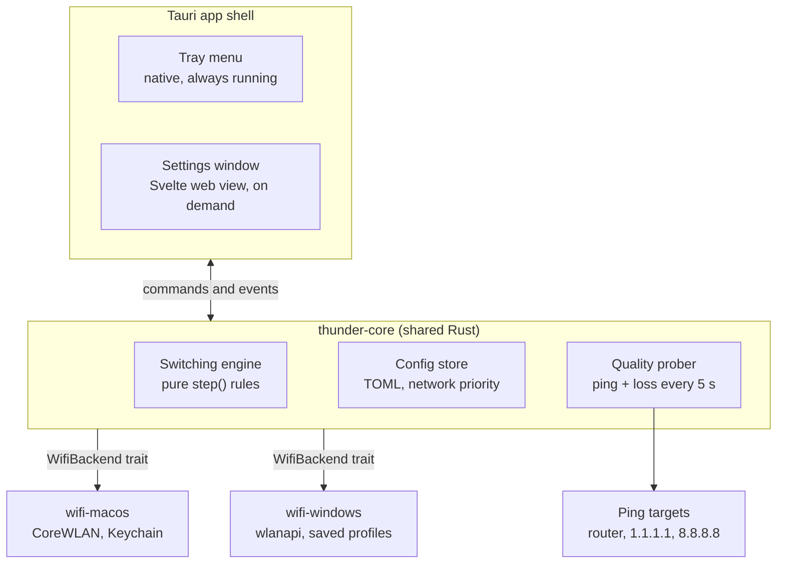

# Thunder WiFi Switcher – Technical Design

Last updated: Nov 20, 2026

Thunder WiFi Switcher is one Rust + Tauri v2 app: a shared core makes every switching decision, and two small platform backends (macOS, Windows) do the Wi-Fi work. This doc is how we build what the [PRD](PRD.md) describes.

## Architecture

Three layers: the Tauri shell shows status, the shared core decides, and one backend per OS talks to the Wi-Fi hardware.



About 80% of the code lives in `thunder-core` and the UI; each backend is a few hundred lines behind the `WifiBackend` trait.

## Repo structure

One Cargo workspace: the core and backends are plain Rust crates, the Tauri app depends on them.

```
Thunder-WiFi-Switcher/
├─ crates/
│  ├─ thunder-core/        # engine, rules, config, quality checks (no OS code)
│  ├─ wifi-macos/          # CoreWLAN + Keychain backend
│  └─ wifi-windows/        # wlanapi backend
├─ app/
│  ├─ src-tauri/           # Tauri shell: tray, windows, commands, autostart
│  └─ ui/                  # settings window (HTML/TS, Svelte)
├─ assets/icons/           # app icons, tray/menu bar template icons
├─ docs/                   # PRD, technical design, decisions (ADRs)
├─ prototype/macos/        # original Swift DormWiFi prototype (reference only)
└─ .github/                # CI workflows, issue templates
```

- `thunder-core` never imports OS code, so it builds and tests on any machine, including Linux CI.
- Each backend crate compiles only on its OS (`#[cfg(target_os = "...")]`).

## Platform interface

The core talks to Wi-Fi only through one trait; each OS crate implements it, and tests use a fake.

```rust
pub trait WifiBackend: Send + Sync {
    /// Current link: SSID, BSSID, RSSI (dBm), channel, or None if disconnected.
    fn current(&self) -> Result<Option<Link>>;
    /// Active scan; blocking, call off the main thread. Returns all visible networks.
    fn scan(&self) -> Result<Vec<ScanResult>>;
    /// Join a network. Password comes from the backend's own store.
    fn connect(&self, ssid: &str) -> Result<()>;
    /// Networks the OS (or our store) can join without asking the user.
    fn known_networks(&self) -> Result<Vec<String>>;
    /// Router / gateway IP for the current link, for the local ping.
    fn gateway(&self) -> Result<Option<IpAddr>>;
    /// Location permission state (needed for SSIDs on both OSes).
    fn permission(&self) -> Permission;
    fn request_permission(&self);
    /// Wi-Fi radio on/off.
    fn powered(&self) -> bool;
}
```

- `Link` and `ScanResult` are plain structs in `thunder-core`; RSSI is always dBm. Windows reports signal as a 0–100% quality, so its backend uses the BSS list's `lRssi` value instead.
- Errors are one enum (`PermissionDenied`, `NotFound`, `AuthFailed`, `Timeout`, `Os(String)`) so the UI can show a clear message.

## macOS backend

`wifi-macos` wraps Apple's CoreWLAN framework from Rust through the `objc2-core-wlan` bindings; the Swift prototype in `prototype/macos` is the reference for each call.

| Need | API |
| --- | --- |
| Current link, RSSI | `CWWiFiClient.shared().interface()` → `ssid()`, `bssid()`, `rssiValue()`; RSSI 0 means not associated |
| Scan | `scanForNetworksWithName(nil)` on a background thread |
| Connect | Scan for that name, pick its strongest access point, `associateToNetwork(network, password)` |
| Known networks | macOS's Known Networks (`configuration().networkProfiles()`) plus networks with a password in the app's Keychain store |
| Passwords | Keychain generic-password items, service `ThunderWiFi`, account = SSID (`PasswordStore`) |
| Gateway | `Router` from the System Configuration key `State:/Network/Global/IPv4`, only when its `PrimaryInterface` is the Wi-Fi interface |
| Location permission | `CLLocationManager.requestWhenInUseAuthorization()` on the main thread, manager kept alive there; without permission SSIDs come back nil and the backend returns `PermissionDenied` |
| Open at login | `SMAppService.mainApp` (Tauri autostart plugin uses it) |
| Sleep / wake | `NSWorkspace` will-sleep / did-wake notifications (`SleepWatcher`) pause the engine |

- Users add a network and its password once in Settings; macOS gives apps no access to the system's saved Wi-Fi passwords.
- `Info.plist` needs `NSLocationWhenInUseUsageDescription` and `LSUIElement = true` (menu bar only, no Dock icon).
- Ad-hoc signed builds trigger a Keychain prompt after each rebuild; Developer ID signing removes it for releases.
- CoreWLAN errors map to the core's `Error`: timeouts → `Timeout`; EAPOL, association-denied, challenge and PMK failures (usually a wrong password) → `AuthFailed`; anything else keeps macOS's message in `Os`.
- `cargo run -p wifi-macos --example probe` exercises every call on real Wi-Fi without the app. `build.rs` embeds an Info.plist in it, so macOS shows it the Location prompt.

## Windows backend

`wifi-windows` calls the Native Wifi API (`wlanapi.dll`) through the official `windows` crate; [ManagedNativeWifi](https://github.com/emoacht/ManagedNativeWifi), used by Wifinian, is a good reference for the call patterns.

| Need | API |
| --- | --- |
| Session | `WlanOpenHandle`, `WlanEnumInterfaces` |
| Current link | `WlanQueryInterface(wlan_intf_opcode_current_connection)` |
| RSSI in dBm | `WlanGetNetworkBssList` → `lRssi` for the connected BSSID |
| Scan | `WlanScan`, then wait for the `scan_complete` notification (`WlanRegisterNotification`) |
| Connect | `WlanConnect` with `wlan_connection_mode_profile` and the saved profile name |
| Known networks | `WlanGetProfileList` (Windows already stores the passwords) |
| Gateway | `GetIpForwardTable2` / adapter info from `iphlpapi` |
| Location permission | Settings → Privacy → Location; on Windows 11 24H2+ SSIDs are hidden without it |
| Open at login | Tauri autostart plugin (HKCU Run key) |

- No passwords are stored by the app on Windows; a network must be saved in Windows first.
- No admin rights are needed for any call above.

## Switching engine

The engine is a state machine with one entry point: `Engine::step(now, event) -> Action`. It reads no clock and touches no OS, so every rule is tested with scripted events. `now` is any monotonic time; only differences matter.

- **Events in:** `Sample` (every 5 s: `WifiOff`, `Disconnected` or `Connected(link)`), `ScanDone(result)`, `ConnectDone { ssid, result }`, `Sleep`, `Wake`. Settings changes go through `Engine::set_config`.
- **Actions out:** `None`, `Scan`, `Connect { ssid }`, `Notify(notice)`. A notice is `Switched { from, to, reason }` or `ConnectFailed { ssid, error }`.
- **Driver:** `thunder_core::Driver` runs the loop against any `WifiBackend`: read a sample, do what the engine asks, feed the result back. The Tauri shell calls it every 5 s on a worker thread; tests call it with the fake backend.

| State | Leaves when | Goes to |
| --- | --- | --- |
| Watching | 3 bad samples in a row (15 s) | Scanning |
| Watching | Disconnected | Scanning (no wait) |
| Scanning | Scan results arrive | Switching if a candidate wins, else Backoff |
| Switching | Connect succeeds or fails | Cooldown 30 s (success) / Backoff (failure) |
| Scanning, Switching | No answer for 60 s | Backoff |
| Cooldown | Timer ends (30 s after a switch, 15 s after waking) | Watching. Samples during a cooldown are ignored. |
| Backoff | A good sample | Watching, and the next backoff starts at 30 s again |
| Backoff | Timer ends (30 s, 60 s, 120 s, 240 s, then 300 s) and the problem is still there | Scanning |
| Backoff | Connection drops while backing off from a weak signal | Scanning (no wait) |
| Paused | User turns auto-switch back on | Watching |
| Paused | Wake from sleep (if the user hadn't paused it) | Cooldown 15 s, so the OS can rejoin a network itself first |

A sample is bad when signal is under the threshold (default -75 dBm; -75 itself is fine). From Phase 4 it is also bad when both public targets show ping over 300 ms or loss over 10%, or the router ping fails.

The engine stays hands-off when Wi-Fi is off, when the user has no enabled networks, and when the laptop is on a network that isn't in the user's list or is turned off there (a café, a phone hotspot). Those samples never start a search.

A candidate wins when it is a saved, enabled network in the scan and scores higher than the current one by a margin:

- Each network is judged by its strongest access point in the scan.
- Signal margin: at least 8 dBm stronger. When disconnected, any candidate will do.
- A network that failed to connect is skipped for 10 minutes, so a wrong password doesn't block the next-best network.
- From Phase 4, when the current problem is internet quality, the candidate must be one not marked "bad internet" in the last 10 minutes; its quality is confirmed right after joining, and a failed check marks it and returns to Backoff.
- User priority breaks ties: higher in the list wins when two candidates are within 3 dBm of the strongest.

All of these numbers are constants in `thunder_core::rules`; only the weak-signal level is a user setting.

## Quality checks

Every 5 seconds the prober sends one probe to each of three targets in parallel and keeps a rolling window of the last 6 results (30 s) per target.

| Target | Method | Timeout |
| --- | --- | --- |
| Router (gateway) | ICMP echo | 1 s |
| 1.1.1.1 | ICMP echo; fallback TCP connect to port 443 | 2 s |
| 8.8.8.8 | ICMP echo; fallback TCP connect to port 443 | 2 s |

- Ping = median round-trip time in the window; loss = failed probes ÷ probes sent.
- ICMP without admin rights: unprivileged datagram ICMP sockets on macOS, `IcmpSendEcho2` on Windows (the `surge-ping` crate covers macOS; Windows gets a small wrapper).
- If ICMP fails for 3 probes while TCP 443 succeeds, the target switches to TCP mode for that network and stays there until the network changes.
- Probes stop while the laptop sleeps, Wi-Fi is off, or the engine is paused.
- Traffic: three tiny packets every 5 s, about 0.1 KB/s.

## Settings and storage

Settings live in one human-readable TOML file; passwords never go in it.

```toml
version = 1
auto_switch = true
weak_signal_dbm = -75
bad_ping_ms = 300
bad_loss_pct = 10
notify_on_switch = false
language = "en"            # "en" | "id"
ping_targets = ["1.1.1.1", "8.8.8.8"]

[[networks]]               # order = priority
ssid = "Dorm-5G"
enabled = true

[[networks]]
ssid = "Dorm-2.4"
enabled = true
```

| OS | Config file | Logs |
| --- | --- | --- |
| macOS | `~/Library/Application Support/ThunderWiFi/config.toml` | `~/Library/Logs/ThunderWiFi/` |
| Windows | `%APPDATA%\ThunderWiFi\config.toml` | `%LOCALAPPDATA%\ThunderWiFi\logs\` |

- `version` allows safe migrations; an unreadable file (not valid TOML) is renamed `config.toml.bak` and defaults are used.
- A valid file with one bad value (wrong type, out of range, unknown language) keeps everything else: only that value falls back to its default, and the change is logged.
- Saving writes a temporary file and renames it, so a crash mid-write never leaves a half-written config.
- History for the graph (nice-to-have) goes in a small SQLite file next to the config, kept 7 days.

## Tray UI and settings window

The tray menu is native (Tauri's tray + menu API); only the settings window is a web view, opened on demand and closed to save memory.

**Tray / menu bar icon:** a template (single-colour) Wi-Fi icon with 0–3 arcs for signal level, a slash when disconnected, plus a short label such as `-58 · 24ms` that users can hide.

**Tray menu:**

1. Status: `Connected: Dorm-5G · -58 dBm · 24 ms`
2. Last event: `15:42 – Switched from Dorm-2.4 (signal -81)`
3. Auto-switch on/off
4. Switch to → submenu of saved networks with last-seen signal
5. Settings…
6. Quit

**Settings window** (about 480 × 560 px), four tabs:

| Tab | Contents |
| --- | --- |
| Networks | Saved list with drag-to-reorder, enable toggle, add/remove; on macOS a password field |
| Rules | Weak-signal slider (-65 to -80), bad ping and loss values, ping targets |
| General | Open at login, notifications, language, show signal label |
| About | Version, check for updates, links to GitHub and privacy note |

The UI is built with Svelte + TypeScript for small bundle size; it talks to Rust through Tauri commands (`get_status`, `get_config`, `save_config`, `switch_to`).

## Testing

| Layer | How | Runs where |
| --- | --- | --- |
| Engine rules | Unit tests with scripted samples (walk away from router, overloaded network, flapping signal, disconnect) | CI on Linux, macOS, Windows |
| Quality checks | Tests against a fake prober with set delays and losses | CI |
| Config | Round-trip, migration and corrupt-file tests | CI |
| Backends | Smoke test: read current link, scan, list known networks | CI macOS and Windows runners (no switching) |
| Real switching | Manual checklist before each release | Your Mac; the Windows tester's laptop |

Manual release checklist (kept in `docs/TESTING.md`): first-run permission prompt, add networks, walk to a weak spot, block internet on one router, sleep and wake, turn Wi-Fi off and on, and check idle CPU and memory against the PRD targets.

A `--simulate` flag replays a recorded sample file through the real UI, so contributors without several networks can still work on it.

## Build and release

GitHub Actions builds every pull request and publishes signed installers when a version tag (`v1.2.3`) is pushed.

| Workflow | Trigger | Does |
| --- | --- | --- |
| `ci.yml` | Every push and pull request | `cargo fmt`, `clippy`, tests on Linux, macOS, Windows; builds the app on macOS and Windows |
| `release.yml` | Tag `v*` | `tauri-action` builds a universal macOS .dmg and Windows .msi (x64, ARM64), signs them, creates a draft GitHub Release |

- macOS signing and notarization: Developer ID certificate and Apple ID app password as repository secrets; until then, unsigned builds with Homebrew `--no-quarantine` instructions.
- Windows signing: SignPath's free open-source plan, called from `release.yml`.
- Auto-update: Tauri updater plugin reads `latest.json` from GitHub Releases; update files are signed with a Tauri key kept in secrets.
- Distribution after v1.0: Homebrew cask and winget manifest, both updated by a workflow step.
- Versioning: SemVer; `CHANGELOG.md` follows Keep a Changelog.

## Security and privacy

The app stores nothing sensitive outside the OS's own secure storage and sends no data anywhere except the probes.

- **Passwords:** macOS Keychain only; never in the config, logs or memory longer than a connect call. Windows: none stored by the app.
- **Location:** requested only because both OSes hide network names without it; no location API is ever read. PRIVACY.md says this in plain words.
- **Network traffic:** only ICMP/TCP probes to the router and the configured targets, plus the update check to GitHub. No analytics, no telemetry.
- **Logs:** SSIDs and signal values only; no passwords, no IP addresses beyond the gateway; rotated at 5 MB.
- **Updates:** signed with the Tauri updater key; the app refuses unsigned update files.
- **Dependencies:** `cargo audit` and Dependabot run weekly; SECURITY.md gives a private reporting address.
- **Least privilege:** no admin rights, no helper daemons, no kernel extensions.
