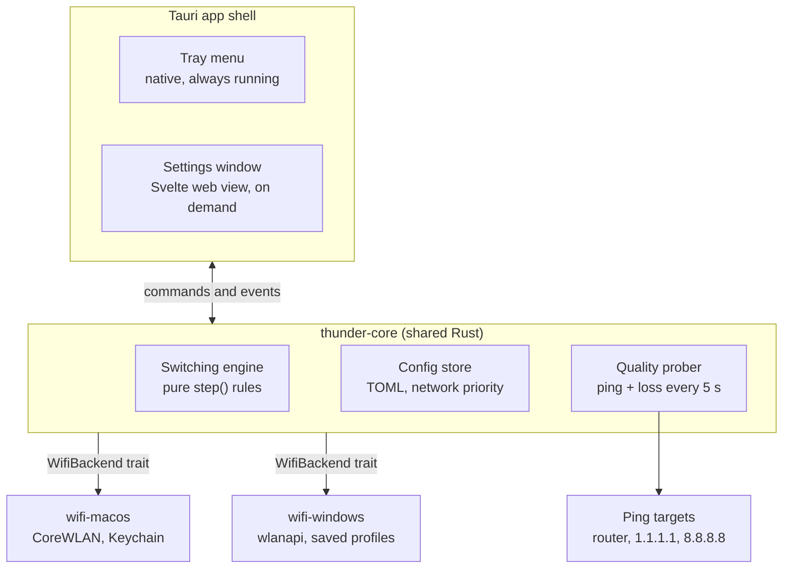

# Thunder WiFi Switcher – Technical Design

Last updated: Nov 20, 2026

Thunder WiFi Switcher is one Rust + Tauri v2 app: a shared core makes every switching decision, and two small platform backends (macOS, Windows) do the Wi-Fi work. This doc is how we build what the [PRD](PRD.md) describes.

## Architecture

Three layers: the Tauri shell shows status, the shared core decides, and one backend per OS talks to the Wi-Fi hardware.



About 80% of the code lives in `thunder-core` and the UI; each backend is a few hundred lines behind the `WifiBackend` trait.

## Repo structure

One Cargo workspace: the core and backends are plain Rust crates, the Tauri app depends on them.

```
Thunder-WiFi-Switcher/
├─ crates/
│  ├─ thunder-core/        # engine, rules, config, quality checks (no OS code)
│  ├─ wifi-macos/          # CoreWLAN + Keychain backend
│  └─ wifi-windows/        # wlanapi backend
├─ app/
│  ├─ src-tauri/           # Tauri shell: tray, windows, commands, autostart
│  └─ ui/                  # settings window (HTML/TS, Svelte)
├─ assets/icons/           # app icons, tray/menu bar template icons
├─ docs/                   # PRD, technical design, decisions (ADRs)
├─ prototype/macos/        # original Swift DormWiFi prototype (reference only)
└─ .github/                # CI workflows, issue templates
```

- `thunder-core` never imports OS code, so it builds and tests on any machine, including Linux CI.
- Each backend crate compiles only on its OS (`#[cfg(target_os = "...")]`).

## Platform interface

The core talks to Wi-Fi only through one trait; each OS crate implements it, and tests use a fake.

```rust
pub trait WifiBackend: Send + Sync {
    /// Current link: SSID, BSSID, RSSI (dBm), channel, or None if disconnected.
    fn current(&self) -> Result<Option<Link>>;
    /// Active scan; blocking, call off the main thread. Returns all visible networks.
    fn scan(&self) -> Result<Vec<ScanResult>>;
    /// Join a network. Password comes from the backend's own store.
    fn connect(&self, ssid: &str) -> Result<()>;
    /// Networks the OS (or our store) can join without asking the user.
    fn known_networks(&self) -> Result<Vec<String>>;
    /// Router / gateway IP for the current link, for the local ping.
    fn gateway(&self) -> Result<Option<IpAddr>>;
    /// Location permission state (needed for SSIDs on both OSes).
    fn permission(&self) -> Permission;
    fn request_permission(&self);
    /// Wi-Fi radio on/off.
    fn powered(&self) -> bool;
    /// One ICMP echo without admin rights (default: unavailable → TCP fallback).
    fn ping(&self, addr: IpAddr, timeout: Duration) -> Result<Duration> { /* … */ }
    /// TCP connect to port 443; "refused" counts as an answer (default: std).
    fn tcp_probe(&self, addr: IpAddr, timeout: Duration) -> Result<Duration> { /* … */ }
}
```

- `Link` and `ScanResult` are plain structs in `thunder-core`; RSSI is always dBm. Windows reports signal as a 0–100% quality, so its backend uses the BSS list's `lRssi` value instead.
- Errors are one enum (`PermissionDenied`, `NotFound`, `AuthFailed`, `NoPassword`, `NeedsUserName`, `WifiOff`, `Timeout`, `Os(String)`) so the UI can show a clear message.

## macOS backend

`wifi-macos` wraps Apple's CoreWLAN framework from Rust through the `objc2-core-wlan` bindings; the Swift prototype in `prototype/macos` is the reference for each call.

| Need | API |
| --- | --- |
| Current link, RSSI | `CWWiFiClient.shared().interface()` → `ssid()`, `bssid()`, `rssiValue()`; RSSI 0 means not associated |
| Scan | `scanForNetworksWithName(nil)` on a background thread |
| Connect | Scan for that name, pick its strongest access point, `associateToNetwork(network, password)`. Nothing found but nameless results → `PermissionDenied`; an access point that only offers WPA Enterprise → `NeedsUserName` (the app can't send a user name yet); a password network with nothing in the Keychain is tried anyway, and a failure becomes `NoPassword` |
| Known networks | macOS's Known Networks (`configuration().networkProfiles()`) plus networks with a password in the app's Keychain store |
| Passwords | Keychain generic-password items, service `ThunderWiFi`, account = SSID (`PasswordStore`) |
| Gateway | `Router` from the System Configuration key `State:/Network/Global/IPv4`, only when its `PrimaryInterface` is the Wi-Fi interface |
| Location permission | `CLLocationManager.requestWhenInUseAuthorization()` on the main thread, manager kept alive there; without permission SSIDs come back nil and the backend returns `PermissionDenied` |
| Open at login | `SMAppService.mainApp` (Tauri autostart plugin uses it) |
| Sleep / wake | `NSWorkspace` will-sleep / did-wake notifications (`SleepWatcher`) pause the engine |
| Notifications | `UNUserNotificationCenter`: `addNotificationRequest` to show one (a delegate asks for a banner even while the app is in front), `getNotificationSettings` to read the permission, `requestAuthorization` to ask; only inside a `.app` bundle |

- Users add a network and its password once in Settings; macOS gives apps no access to the system's saved Wi-Fi passwords.
- `Info.plist` needs `NSLocationWhenInUseUsageDescription` and `LSUIElement = true` (menu bar only, no Dock icon).
- Tauri signs the bundle with the hardened runtime, so `Entitlements.plist` must include `com.apple.security.personal-information.location`; without it macOS silently skips the Location prompt (locationd logs "has supported the hardened runtime but doesn't have the entitlement").
- Ad-hoc signed builds trigger a Keychain prompt and lose Location permission after each rebuild, and releases do the same after each update: the app has no Apple Developer ID (decided in November 2026, to keep the project free). After an update, the settings window opens by itself with the setup guide.
- macOS reports the Location permission state asynchronously, through a location manager on the main thread, so the backend keeps one alive there from startup. Whether names are hidden is judged from what CoreWLAN returns, not from that state.
- CoreWLAN errors map to the core's `Error`: timeouts → `Timeout`; EAPOL, association-denied, challenge and PMK failures (usually a wrong password) → `AuthFailed`; anything else keeps macOS's message in `Os`. Saying no to the Keychain prompt gives an `Os` message that says to choose Always Allow.
- macOS only shows the Location prompt to processes launched as apps. A binary started from Terminal (including `tauri dev`) is never asked, so real-Wi-Fi testing needs a bundled build opened with `open`.
- `scripts/probe-macos.sh` exercises every backend call on real Wi-Fi without the app: it wraps the `probe` example in a small app bundle and launches it with `open`, with the terminal as its input and output.

## Windows backend

`wifi-windows` calls the Native Wifi API (`wlanapi.dll`) through the official `windows` crate; [ManagedNativeWifi](https://github.com/emoacht/ManagedNativeWifi), used by Wifinian, is a good reference for the call patterns.

| Need | API |
| --- | --- |
| Session | `WlanOpenHandle` per call, `WlanEnumInterfaces`; uses the connected adapter, else the first |
| Current link | `WlanQueryInterface(wlan_intf_opcode_current_connection)`; `ERROR_INVALID_STATE` means not connected |
| RSSI in dBm | `WlanGetNetworkBssList` → `lRssi` for the connected BSSID (0–100 signal quality only as a fallback); channel from `ulChCenterFrequency` |
| Scan | `WlanScan`, then wait up to 5 s for `scan_complete` / `scan_fail` (`WlanRegisterNotification`); the BSS list is read either way |
| Connect | Find the network's saved profile in `WlanGetAvailableNetworkList`, `WlanConnect` with `wlan_connection_mode_profile`, wait up to 20 s for `connection_complete` / `connection_attempt_fail`; reason codes from the security module map to `AuthFailed`; a network in range without a saved profile → `NoPassword` |
| Known networks | `WlanGetProfileList` (Windows already stores the passwords) |
| Radio on/off | `WlanQueryInterface(wlan_intf_opcode_radio_state)`: on only if both the switch and the setting are on |
| Gateway | `GetIpForwardTable2(AF_INET)`: the default route of the Wi-Fi adapter's LUID with the lowest metric |
| Location permission | On Windows 11 24H2+ wlanapi answers `ERROR_ACCESS_DENIED` when location is off for desktop apps → `PermissionDenied`; `request_permission` opens `ms-settings:privacy-location` (desktop apps can't show the prompt themselves) |
| Sleep / wake | `PowerRegisterSuspendResumeNotification` with a callback (`PowerWatcher`): `PBT_APMSUSPEND` → sleep, `PBT_APMRESUMEAUTOMATIC` → wake |
| Open at login | Tauri autostart plugin (HKCU Run key) |

- No passwords are stored by the app on Windows; a network must be saved in Windows first. Connecting to one that isn't says so.
- No admin rights are needed for any call above.
- `WlanReasonCodeToString` isn't used: the `windows` crate binds its output buffer as read-only, so failures report the reason code instead.
- `cargo run -p wifi-windows --example probe` exercises every call on real Wi-Fi without the app.

## Switching engine

The engine is a state machine with one entry point: `Engine::step(now, event) -> Action`. It reads no clock and touches no OS, so every rule is tested with scripted events. `now` is any monotonic time; only differences matter.

- **Events in:** `Sample` (every 5 s: `WifiOff`, `Disconnected` or `Connected(link)`), `ScanDone(result)`, `ConnectDone { ssid, result }`, `Sleep`, `Wake`. Settings changes go through `Engine::set_config`.
- **Actions out:** `None`, `Scan`, `Connect { ssid }`, `Notify(notice)`. A notice is `Switched { from, to, reason }` or `ConnectFailed { ssid, error }`.
- **Driver:** `thunder_core::Driver` runs the loop against any `WifiBackend`: read a sample, do what the engine asks, feed the result back. The Tauri shell calls it every 5 s on a worker thread; tests call it with the fake backend.

| State | Leaves when | Goes to |
| --- | --- | --- |
| Watching | 3 bad samples in a row (15 s) | Scanning |
| Watching | Disconnected | Scanning (no wait) |
| Scanning | Scan results arrive | Switching if a candidate wins, else Backoff |
| Switching | Connect succeeds or fails | Cooldown 30 s (success) / Backoff (failure) |
| Scanning, Switching | No answer for 60 s | Backoff |
| Cooldown | Timer ends (30 s after a switch, 15 s after waking) | Watching. Samples during a cooldown are ignored. |
| Backoff | A good sample | Watching, and the next backoff starts at 30 s again |
| Backoff | Timer ends (30 s, 60 s, 120 s, 240 s, then 300 s) and the problem is still there | Scanning |
| Backoff | Connection drops while backing off from a weak signal | Scanning (no wait) |
| Paused | User turns auto-switch back on | Watching |
| Paused | Wake from sleep (if the user hadn't paused it) | Cooldown 15 s, so the OS can rejoin a network itself first |

A sample is bad when signal is under the threshold (default -75 dBm; -75 itself is fine), or when the quality checks say the router is failing (`BadLink`) or both public targets show ping over 300 ms or loss over 10% with at least 2 lost probes (`BadInternet`). A weak signal is checked first, since it explains the rest. Each sample carries the verdict: `Sample::Connected(link, internet)`.

The engine stays hands-off when Wi-Fi is off, when the user has no enabled networks, and when the laptop is on a network that isn't in the user's list or is turned off there (a café, a phone hotspot). Those samples never start a search.

A candidate wins when it is a saved, enabled network in the scan and scores higher than the current one by a margin:

- Each network is judged by its strongest access point in the scan.
- Signal margin: at least 8 dBm stronger. When disconnected, any candidate will do.
- A network that failed to connect is skipped for 10 minutes, so a wrong password doesn't block the next-best network.
- Picking a network while Wi-Fi is off fails straight away with `WifiOff`, and nothing is skipped because of it.
- When the problem is internet quality (`BadInternet` or `BadLink`), the current network is marked when the search starts and skipped for 10 minutes. Instead of the 8 dB margin, a candidate only needs a signal that isn't weak (at or above the weak-signal level). After joining, its quality is checked like any network: if it's bad too, it gets marked and the search continues; with nothing left, the engine backs off.
- User priority breaks ties: higher in the list wins when two candidates are within 3 dBm of the strongest.

All of these numbers are constants in `thunder_core::rules`; only the weak-signal level is a user setting.

## Quality checks

Every 5 seconds the prober sends one probe to each of three targets in parallel and keeps a rolling window of the last 6 results (30 s) per target.

| Target | Method | Timeout |
| --- | --- | --- |
| Router (gateway) | ICMP echo; fallback TCP connect to port 443 | 1 s each |
| 1.1.1.1 | ICMP echo; fallback TCP connect to port 443 | 2 s each |
| 8.8.8.8 | ICMP echo; fallback TCP connect to port 443 | 2 s each |

- `thunder_core::quality::Prober` runs the probes on scoped threads (a tick takes at most about 4 s) and starts a new window whenever the network name changes. The first 2 rounds on a network (10 s), and after a reset, probe nothing: while the laptop is still getting an address, lost pings say nothing about the network. The `Driver` calls it on each tick while connected and not paused, and puts the verdict in the sample.
- Ping = median round-trip time in the window (the upper middle for an even count); loss = failed probes ÷ probes sent. A target is judged only once it has 3 results (15 s, so about 25 s after joining). Loss counts only when at least 2 probes in the window got no answer: one lost ping in 6 is normal on Wi-Fi.
- A failed ping is retried right away as a TCP connection to port 443, so networks that drop ICMP don't look lossy. If that happens 3 times, the target switches to TCP for that network and stays there until the network changes. A refused connection counts as an answer.
- The router counts only if it has answered at least once on this network: some routers ignore ping and have no port 443, and they shouldn't look broken.
- ICMP without admin rights: an unprivileged datagram ICMP socket on macOS (`socket2`; replies are matched by sequence number and an 8-byte token), `IcmpSendEcho` on Windows. IPv6 targets use the TCP check.
- Probes stop while the laptop sleeps, Wi-Fi is off, or the engine is paused.
- When the verdict turns bad, the log lists what each target did (`router 192.168.1.1: 0 of 6 lost, 4 ms · 1.1.1.1: 2 of 6 lost, 41 ms`), so a network report shows why.
- Traffic: three tiny packets every 5 s, about 0.1 KB/s.
- The tray shows the best public median: `-58 · 24ms` next to the icon, `Connected: Dorm-5G · -58 dBm · 24 ms` in the menu, and "no internet", "slow internet" or "router not responding" when the checks say so.

## Settings and storage

Settings live in one human-readable TOML file; passwords never go in it.

```toml
version = 1
auto_switch = true
weak_signal_dbm = -75
bad_ping_ms = 300
bad_loss_pct = 10
notify_on_switch = false
check_for_updates = true
language = "en"            # "en" | "id"
ping_targets = ["1.1.1.1", "8.8.8.8"]

[[networks]]               # order = priority
ssid = "Dorm-5G"
enabled = true
place = "Dorm"             # optional; groups the list and menu

[[networks]]
ssid = "Dorm-2.4"
enabled = true
place = "Dorm"
```

**Places.** A network may have a place ("Dorm", "Office"). The current place is the place of the network the laptop is on; it's worked out from Wi-Fi alone, never from location. Places only change what's shown:
- the Networks tab groups the list by place (no place last);
- **Switch to** lists the current place's networks plus the ones with no place, and says the place in its label; off a placed network it lists all of them;
- the window's status line starts with the place.

Places never limit switching. The engine always picks from the saved networks in range, so walking from the dorm to the office next door still moves to the office network while the dorm one fades.

| OS | Config file | Logs |
| --- | --- | --- |
| macOS | `~/Library/Application Support/ThunderWiFi/config.toml` | `~/Library/Logs/ThunderWiFi/` |
| Windows | `%APPDATA%\ThunderWiFi\config.toml` | `%LOCALAPPDATA%\ThunderWiFi\logs\` |

- `version` allows safe migrations; an unreadable file (not valid TOML) is renamed `config.toml.bak` and defaults are used.
- A valid file with one bad value (wrong type, out of range, unknown language) keeps everything else: only that value falls back to its default, and the change is logged.
- Saving writes a temporary file and renames it, so a crash mid-write never leaves a half-written config.
- History for the graph (nice-to-have) goes in a small SQLite file next to the config, kept 7 days.

## Tray UI and settings window

The tray menu is native (Tauri's tray + menu API); only the settings window is a web view, opened on demand and closed to save memory.

**Tray / menu bar icon:** a template (single-colour) Wi-Fi icon with 0–3 arcs for signal level (3 at -60 dBm or better, 2 down to -70, 1 down to -80, 0 below), a slash when disconnected, plus a short label such as `-58` (`-58 · 24ms` once ping arrives) that users can hide. Windows shows the colour icon until it has light and dark variants.

**Tray menu:**

1. Status: `Connected: Dorm-5G · -58 dBm` (ping joins it in Phase 4)
2. Last event: `15:42 – Switched from Dorm-2.4 to Dorm-5G (signal was -81 dBm)`
3. Auto-switch on/off
4. Switch to ("Switch to · Dorm" in a place) → submenu of the enabled networks in the current place plus those with no place, or all of them when the current network has no place; the current one checked (works even while auto-switch is off)
5. Settings…
6. Quit

**Worker thread:** `app/src-tauri/src/worker.rs` owns the `Driver` and is the only thread that touches the Wi-Fi radio. It ticks every 5 s, takes commands (new settings, sleep/wake, "switch to", scan for the settings window), and publishes a `Status` whenever it changes; the shell redraws the tray from it and emits it to the settings window as a `status` event. Sleep and wake come from `SleepWatcher` on the main thread.

**First run:** with no settings file (or no networks), the settings window opens on launch with the setup guide at the top of the Networks tab. It lists everything the app asks for, says what each is for and quotes what the system will show, so no prompt comes as a surprise:

| Step | Needed? | What the user sees |
| --- | --- | --- |
| Location (macOS) / location for desktop apps (Windows) | Yes | macOS: "would like to use your current location", choose Allow. Windows: the Location settings page. |
| Your networks | Yes | macOS: each password is typed once and kept in the Keychain; the first join asks to "use your confidential information stored in 'ThunderWiFi'", choose Always Allow. Windows: connect once from the Windows Wi-Fi menu. |
| Notifications | No | macOS asks once, in a notification: choose Allow (it may be under Options). |
| Open at login | No | macOS shows "Background Items Added"; that's this app. |

Each step shows its state (Needed, Done, Turned off, On, Off, Blocked). The first unfinished needed step is open; the others open on a click. The guide opens by itself whenever a needed step is missing (also when Location is turned off later), stays until the user clicks **Done** after finishing, and comes back from About → **Setup guide**. Once Location is allowed, the Nearby list scans again by itself. A settings file that couldn't be read shows a one-time notice.

**Other pieces:** switch notifications (off by default) are sent from Rust only, so the window gets no notification permission: on macOS by `wifi-macos` with Apple's current framework, on Windows by the Tauri notification plugin. macOS refuses every notification from an app that mixes Apple's old framework (which the plugin uses) with the new one (which reads the permission), so the plugin isn't used there. Only automatic switches notify ("Switched to Dorm-2.4" / "Dorm-5G's signal was weak (-81 dBm)."); switches the user made, and failed joins, don't. Turning the setting on sends a test notification, so the user sees one straight away, or learns that the system blocks them. macOS asks each app once whether it may show notifications; after Don't Allow they only go to Notification Center, and only System Settings can change that. The plugin can't tell, so on macOS the app reads and asks with `UNUserNotificationCenter` (`wifi-macos`, commands `notification_permission` and `ask_notification_permission`): it asks the moment the user ticks the box, and while notifications are on but blocked (denied, or banner style None) the General tab says so, with **Open notification settings** (the app's own page in System Settings → Notifications). It checks again whenever the window gets focus. That framework only works inside a real `.app`, so it isn't called anywhere else (the answer is then "unknown"). Windows has no such question: the tab just offers `ms-settings:notifications`. Open at login uses the Tauri autostart plugin's Launch Agent; a second launch just opens the settings window (single-instance plugin); logs go to `~/Library/Logs/ThunderWiFi/thunderwifi.log` (rotated at 5 MB, network names and signal only). `--simulate` swaps in the fake backend with three networks on a 6-minute loop and its own settings file.

**Settings window** (about 480 × 560 px), four tabs:

| Tab | Contents |
| --- | --- |
| Networks | Saved list grouped by place, with drag-to-reorder (dropping on another place moves it there), enable toggle, place, add/remove; on macOS a password field |
| Rules | Weak-signal slider (-65 to -80), bad ping and loss values, ping targets |
| General | Open at login, notifications, check for updates, language, show signal label |
| About | Version, check for updates, links to GitHub and privacy note |

The UI is built with Svelte + TypeScript for small bundle size; it talks to Rust through Tauri commands (`get_status`, `get_config`, `save_config`, `switch_to`, plus `nearby_networks`, `known_networks`, `password_status`, `set_password`, `delete_password`, `request_permission`, `open_link`, `get_autostart`, `set_autostart`, `app_info`, `startup_notice`) and listens for `status` and `config` events. Every change saves straight away. **Join now** calls `switch_to`, which waits (up to 90 s) for the worker to join; on failure it returns a `JoinError` (`kind` plus a plain message for this OS, from `status.rs`), shown under that network with a fix where there is one: add or change the password, allow Location, or try again. The message hides itself after 5 seconds, but not while the pointer or keyboard focus is on it. Passwords only travel from the window to the Keychain, never back. In a plain browser the window uses a pretend backend (`ui/src/lib/mock.ts`).

## Testing

| Layer | How | Runs where |
| --- | --- | --- |
| Engine rules | Unit tests with scripted samples (walk away from router, overloaded network, flapping signal, disconnect) | CI on Linux, macOS, Windows |
| Quality checks | Tests against a fake prober with set delays and losses | CI |
| Config | Round-trip, migration and corrupt-file tests | CI |
| Backends | Smoke test: read current link, scan, list known networks | CI macOS and Windows runners (no switching) |
| Real switching | Manual checklist before each release | Your Mac; the Windows tester's laptop |

Manual release checklist (kept in `docs/TESTING.md`): first-run permission prompt, add networks, walk to a weak spot, block internet on one router, sleep and wake, turn Wi-Fi off and on, and check idle CPU and memory against the PRD targets.

A `--simulate` flag replays a recorded sample file through the real UI, so contributors without several networks can still work on it.

## Build and release

GitHub Actions builds every pull request and attaches installers to a draft release when a version tag (`v1.2.3`) is pushed.

| Workflow | Trigger | Does |
| --- | --- | --- |
| `ci.yml` | Pushes to `main` and every pull request | `cargo fmt`, `clippy`, tests on Linux, macOS, Windows; builds the app on macOS and Windows |
| `release.yml` | Tag `v*`; pull requests that change it | `tauri-action` builds a universal macOS .dmg and Windows .msi (x64, ARM64). A tag creates a draft GitHub Release, never marked as a pre-release (installed apps only see the latest release), with signed update files and `latest.json`; it stops if the tag doesn't match the `Cargo.toml` version. A pull request only uploads the installers as workflow artifacts |

- The `Cargo.toml` version stays plain numbers, because MSI versions can't carry labels. Every release that should reach installed apps needs a higher version (0.5.0, 0.5.1, …), betas included. A tag may carry a label for people (`v0.5.1-beta.2`), but the updater only compares versions.
- macOS: no Apple Developer ID, so no notarization. Release builds are ad-hoc signed (`signingIdentity: "-"`, with the location entitlement), the README explains the one-time **Open Anyway** step, and each update makes macOS ask for Location (and the Keychain) again.
- Windows signing: SignPath's free open-source plan, called from `release.yml`.
- Auto-update (`updates.rs`, Tauri updater plugin):
  - The app reads `latest.json` from the latest GitHub Release a minute after starting, then twice a day (by the clock, so time asleep counts) while **Check for updates automatically** is on, and whenever the user clicks About → **Check for updates**. GitHub answering "not found" (nothing published yet, or no build for this computer) counts as up to date; only a network problem or a broken file shows an error.
  - A newer version downloads in the background. It installs only when the user chooses **Restart to Update** (top of the menu, or About). macOS: the new `.app` replaces the old one and the app restarts. Windows: the `.msi` installs in passive mode (a progress bar) and reopens the app.
  - `release.yml` signs the update files with the Tauri key (secrets `TAURI_SIGNING_PRIVATE_KEY` and `TAURI_SIGNING_PRIVATE_KEY_PASSWORD`); the public key is in `tauri.conf.json`, and the app refuses files that don't match. Builds without the key (`run-app-macos.sh`, pull requests from Dependabot) pass `--config` with `createUpdaterArtifacts: false`.
  - When an update makes macOS forget Location, the first status that says so opens the settings window, where the setup guide waits.
- Distribution after v1.0: our own Homebrew tap (the official homebrew-cask disables apps that fail macOS's Gatekeeper check from September 2026) and a winget manifest, both updated by a workflow step.
- Versioning: SemVer; `CHANGELOG.md` follows Keep a Changelog.

## Security and privacy

The app stores nothing sensitive outside the OS's own secure storage and sends no data anywhere except the probes.

- **Passwords:** macOS Keychain only; never in the config, logs or memory longer than a connect call. Windows: none stored by the app.
- **Location:** requested only because both OSes hide network names without it; no location API is ever read. PRIVACY.md says this in plain words.
- **Network traffic:** only ICMP/TCP probes to the router and the configured targets, plus the update check to GitHub. No analytics, no telemetry.
- **Logs:** SSIDs and signal values only; no passwords, no IP addresses beyond the gateway; rotated at 5 MB.
- **Updates:** signed with the Tauri updater key; the app refuses unsigned update files.
- **Dependencies:** `cargo audit` and Dependabot run weekly; SECURITY.md gives a private reporting address.
- **Least privilege:** no admin rights, no helper daemons, no kernel extensions.
